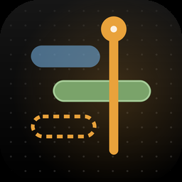
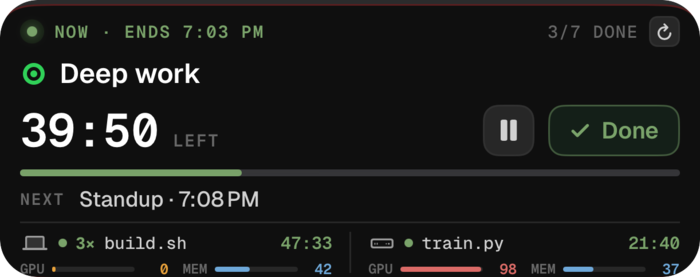
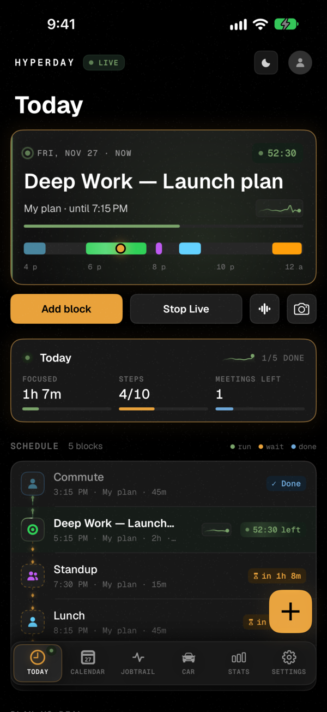
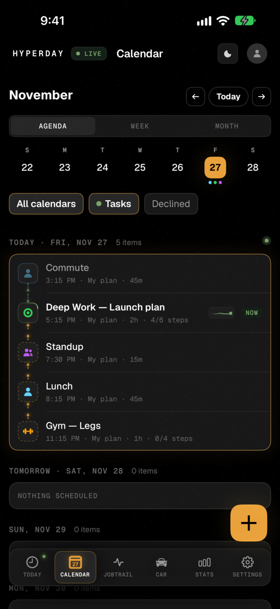
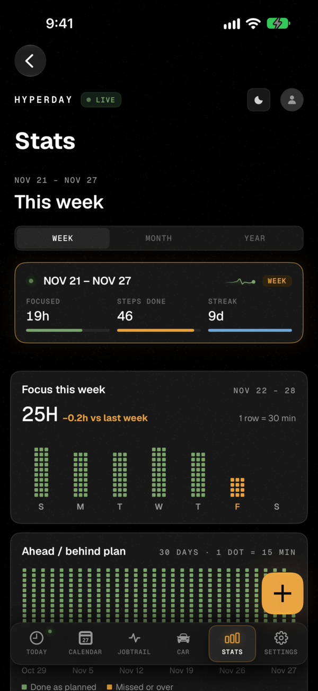
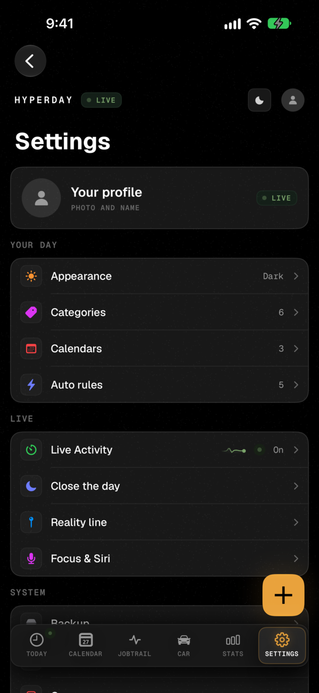
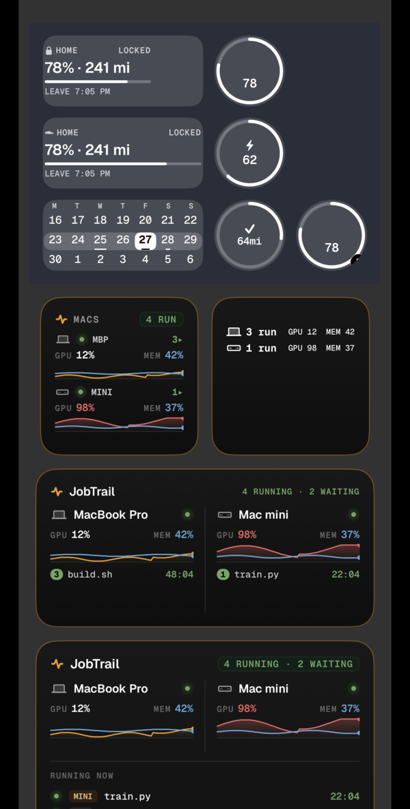

  

<h1 align="center">Hyperday</h1>

  <b>Your day, live on your Lock Screen.</b>

  <a href="#download">Download</a> ·
  <a href="https://github.com/prabhuSub/Hyperday/issues">Report an issue</a> ·
  <a href="docs/PRIVACY.md">Privacy</a>

  
  
  
  
  
  

---

Hyperday turns your calendar and your own plan into one live card on your iPhone. Glance at your Lock Screen and see **what you're doing now, what's next, and how far along you are**. Tap once to check off a step.

## See it

### Your day on the Lock Screen

The Hyperday card sits on your Lock Screen and in the Dynamic Island all day.

- **Top:** what you're doing now, when it ends, and how many blocks are done.
- **Middle:** a big countdown, with **Pause** and **Done** buttons you can tap without unlocking.
- **Bar:** fills in as the block goes on; **Next** shows what's coming.
- **Bottom:** your Macs at a glance (running jobs, GPU and memory) when JobTrail is connected.
- **Alerts:** a red line appears only while something needs you, like a Mac below 20 % battery or a Mac that lost power.

When your day is done, the card turns into a board of your Macs. Tap it to open the JobTrail tab.

**How to start:** open Hyperday and tap **Go Live**, then lock your phone.

### Today

Your day at a glance.

- The big card is what you're doing **right now**, with a strip of your whole day and a marker at now.
- **Focused · Steps · Meetings left** show how the day is going.
- Below is your schedule: meetings from your calendar and blocks you planned, each in its color, with what's done, running and waiting.

**How to use it:** tap **Add block** to plan something. Tap any item to add steps or change it. Tap **Today** in the tab bar to jump back to the top.

 

### Calendar

All your calendars in one place together with your own plans.

- **Agenda:** your week, day by day.
- **Week:** hours side by side. Long-press and drag a block you planned to move it (it snaps to 15 minutes), or pull its bottom edge to change its length.
- **Month:** the big picture, with colored dots for what's on each day.

**How to use it:** tap a date to jump to it. Use the **Tasks** and **Declined** chips to show or hide items.

 

### Stats

See where your time actually goes.

- **Focused hours, steps done** and your **streak**.
- **Focus this week:** a dot grid of focused time per day, compared with last week.
- **Ahead / behind plan:** every day of the last 30, done as planned or missed.

**How to use it:** switch between **Week, Month and Year**. Every Sunday evening you get a weekly recap you can share.

 

### Make it yours

- **Light, Dark or System** appearance.
- **Categories** and **Auto rules:** for example, anything with "gym" in the title is Fitness.
- **Calendars:** pick which ones show and give each its own color.
- **Live Activity:** turn it on or off, and switch **Mac alerts** on if you want them.

 

### JobTrail and your car

- **JobTrail tab:** if you run [JobTrail](https://github.com/prabhuSub/jobtrail) on your Macs, Hyperday shows its live map, jobs and each Mac's vitals (CPU, chip temperature, fans, battery) over Tailscale.
- **Car tab:** sign in with Tesla once to see battery, range, lock and Sentry state, and whether you have enough range for today's trips. Your login stays in your iPhone's Keychain.

### Widgets

- **Lock Screen:** car battery and range, lock state, charging ring, and a month calendar with a dot for each finished day.
- **Home Screen:** your Macs (small, medium and large) with GPU and memory graphs and what's running now.
- **Day widgets:** the current block, your day strip, and a blocks-done heatmap.

 

## Also works with

- **Apple Watch:** while a block is live, it shows up in the Smart Stack with the time left and a Done button. No separate Watch app needed.
- **Siri & Shortcuts:** "What's next in Hyperday", "Start my day in Hyperday", "I'm done in Hyperday", "Add a block in Hyperday" and **Start Deep Work**.
- **Focus:** add a Hyperday filter to a Focus to see only work, only personal, or nothing.
- **Dynamic Island:** your countdown and progress while you use other apps.

## Privacy

Your day stays on your iPhone.

- No account, no sign-up, no ads, no tracking.
- Hyperday **reads** your calendars to show them. It never changes them.
- Everything you create is stored only on your phone. Delete the app and it's gone.
- JobTrail and Tesla are optional. JobTrail talks only to your own Macs over Tailscale; Tesla data comes straight from Tesla to your phone.

Read the full [privacy policy](docs/PRIVACY.md).

## Download

Hyperday is in **early preview** and isn't on the App Store yet. Star this repository to hear when the beta opens.

Developers can build it themselves: see [docs/DEVELOPMENT.md](docs/DEVELOPMENT.md).

## Coming soon

- On-time switching at the exact start of each block
- iCloud sync between your devices

## FAQ

**Does Hyperday change my calendar?** No. It only reads it. Blocks and steps you create live in Hyperday.

**Does it need internet?** No. Your day works offline. JobTrail and the Car tab need a connection.

**Why does the card sometimes lag behind the clock?** iOS decides when apps can refresh in the background. Opening Hyperday or tapping the card's button updates it right away. On-time switching is on the roadmap.

**Which iPhones?** iPhone with iOS 18 or later. The Dynamic Island needs iPhone 14 Pro or newer.

---

Screens show sample data, captured from the current build (v79). Hyperday is an independent project, not affiliated with Apple Inc. or Tesla, Inc. Copyright © 2026 Prabhu Subramanian. All rights reserved.
